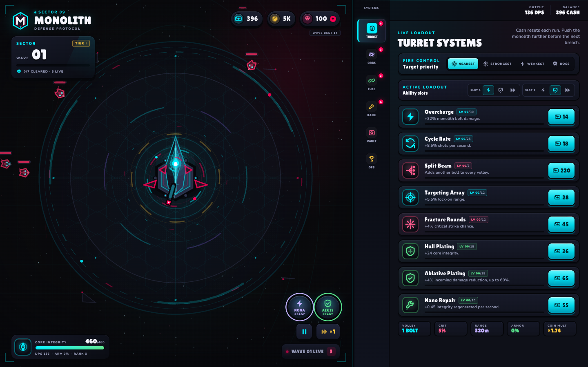
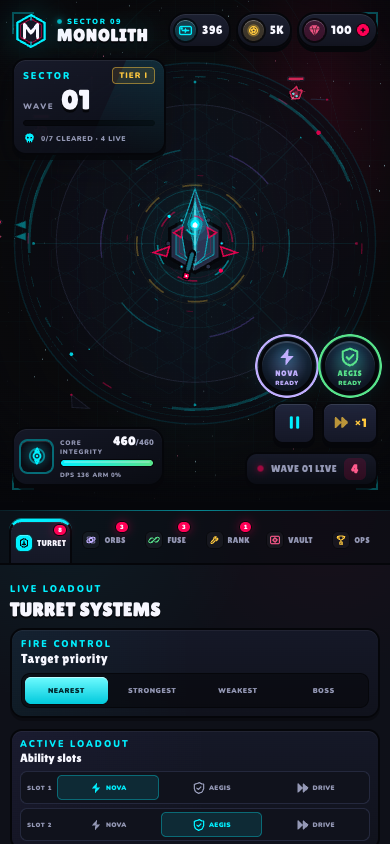

# MONOLITH // Tower Defense

A playable incremental tower defense built with **Vite, TypeScript, React, Pixi.js, Zustand, and Decimal.js**. The visual direction is a dark sci-fi monolith arena with the chunky, toy-like interface language of a Brawl Stars-style mobile game.

## Live

**Play it here:** https://dasclown.github.io/monolith/

**Source:** https://github.com/DasClown/monolith

## Preview





Feature captures: [Ability loadout](docs/preview-abilities.png), [Daily OPS](docs/preview-ops.png), [Prestige skill tree](docs/preview-tree.png), [Display settings](docs/preview-settings.png), [Fusion matrix](docs/preview-fusion.png), [Roguelite banner choice](docs/preview-banners.png), [Offline salvage](docs/preview-offline.png), [Health bars at close range](docs/preview-healthbars.png).

## Run

```bash
npm install
npm run dev
```

Open the printed local URL. To verify a production bundle:

```bash
npm run typecheck
npm test
npm run build
npm run preview
```

### Deploy to GitHub Pages

Pushing to `main` runs [.github/workflows/deploy.yml](.github/workflows/deploy.yml). The workflow installs dependencies, runs the tests, builds with `npm run build:pages`, and deploys `dist` to GitHub Pages.

`build:pages` uses Vite mode `pages` with the `/monolith-defense/` base path. PWA links and service-worker registration use `import.meta.env.BASE_URL` and `%BASE_URL%`.

## Layout

- **Desktop, 1180 px and wider:** the battlefield takes 60% of the width and the systems panel is a full-height 40% sidebar on the right. Tabs form a vertical SYSTEMS rail, and the content area uses the full viewport height. Actionable upgrades come before status and summary cards in every tab.
- **Tablet and mobile, below 1180 px:** the panel returns to a 60/40 stacked bottom sheet with horizontal tabs. This keeps the battlefield readable on phones.
- At 1440 x 900, all six tabs fit without body scrolling. Upgrade cards are always placed before status summaries, so purchases stay visible first. Smaller viewports only scroll the panel body, never the page.

## Mobile and PWA

The game is a responsive mobile web app. It switches to a compact phone layout with touch-sized ability buttons, six drawer tabs, safe-area padding, and a stacked OPS/settings view.

It is also an installable PWA:

- Web app manifest and generated 192/512 icons
- Standalone display mode and mobile status-bar metadata
- Service worker with an app-shell cache and runtime caching
- Offline reload after the first controlled visit
- Install prompt in the OPS tab when the browser exposes `beforeinstallprompt`

There is no separate App Store/Play Store binary yet. For a native shell, the PWA can be wrapped with Capacitor without rewriting the game.

## Controls

- **First start:** wave 1 waits in STANDBY until you press **START WAVE**. Open OPS and configure your loadout first. After the first start, intermissions auto-launch as before.
- **Space / P:** pause or resume the simulation.
- **N / M:** trigger ability slot 1 or slot 2.
- **1 / 2 / 3:** set game speed to 1x, 2x, or 3x. During a banner reward, these keys pick the three offered banners instead.
- **Launch Early:** start the next wave during later intermissions for bonus cash.
- **Turret target priority:** NEAREST, STRONGEST, WEAKEST, or BOSS.
- **Ability loadout:** in TURRET, choose a different ability for slot 1 or slot 2. Equipping an already-used ability swaps the two slots.
- **OPS tab:** pilot name and tag, local leaderboard, save export/import, daily contracts, display settings, and PWA install.
- **Gems:** tap the gem pill to jump to the vault.

## Game loop

1. Enemies converge on the central monolith from an outer ring.
2. The monolith auto-targets, aims, and fires homing kinetic bolts.
3. Projectiles use a spatial hash for deterministic broad-phase and circle narrow-phase collision.
4. Target priority can be switched between nearest, strongest, weakest, and boss focus.
5. Active abilities provide burst, barrier, or fire-rate windows. Their cooldowns are independent.
6. Waves from 3 onward roll mutators. The wave card previews the next composition and mutators.
7. Plasma Burn, Stasis Field, and Arc Conduit add thermal burn, slow, and arc chains. Combining them activates automatic fusion synergies.
8. Every third wave offers a roguelite banner choice. Picks stack and last for the current run.
9. Bosses expose weak points, enrage at health thresholds, and use archetype-specific attacks.
10. Kills award run cash; clearing a wave awards meta coins.
11. Spend cash on the current run, then spend coins in the permanent workshop.
12. If the core reaches zero integrity, the run ends but coins, gems, cores, workshop, skill-tree nodes, and entitlements persist.
13. Prestige, daily contracts, and offline salvage provide long-term progression.

Waves scale exponentially in health, damage, spawn rate, and tier. Bosses rotate every fifth wave.

## Architecture

```text
src/
  config/     tower, wave, prestige, offline, mutator, and synergy balance
  core/       fixed-timestep loop, deterministic math/RNG, collision, types
  entities/   Tower, seven enemy archetypes, Projectile, Orbital
  systems/    Economy, Upgrades, Waves, Banners, Abilities, Prestige, Daily, Offline, Monetization
  game/       GameSession coordinator, commands, save v2 and migrations
  render/     Pixi layers, sprites, effects pool, range/threat indicators
  store/      Zustand run snapshot and persistent display settings
  ui/         responsive HUD, six-tab drawer, OPS board, overlays
tests/        deterministic systems tests with Vitest
public/       PWA manifest, service worker, generated icons
```

The simulation runs at a fixed **60 ticks per second**. The renderer receives an interpolation alpha and never writes simulation state. React receives throttled snapshots, so 60 TPS does not cause 60 React renders per second.

## Systems

### Damage types and resistances

- **Kinetic:** monolith bolts and orbital blades. Reduced by physical armor.
- **Thermal:** Plasma Burn damage-over-time. Bypasses physical armor but is reduced by thermal resistance.
- **Arc:** Arc Conduit chains and Nova Pulse. Reduced by arc resistance.

Enemy health bars show small colored resistance pips. Warden resists kinetic and arc; Brute resists thermal and arc; new bosses have their own profiles. This creates a reason to mix bolt, burn, chain, and Nova damage instead of stacking one channel.

### Abilities and loadout

Three active abilities share one loadout system with two equipped slots:

- **Nova Pulse:** radial arc burst, 24s base cooldown, scales from tower damage and Triad Cascade.
- **Aegis Field:** grants a barrier equal to 35% integrity, repairs 10%, 32s cooldown. The barrier is drawn as a cyan segment on the integrity bar and a reinforced shield ring.
- **Overdrive:** +60% fire rate and +25% damage for 8s, 40s cooldown. It has a gold tower aura and an `ACTIVE` button state.

Cooldowns persist in the run but reset on redeploy or prestige. The equipped pair and slot order persist in save data.

### Fusion and orbitals

- **Plasma Burn:** thermal damage-over-time that scales with tower damage.
- **Stasis Field:** slows enemies with a cyan status aura.
- **Arc Conduit:** chains arc damage to nearby targets.
- **Thermal Shock:** burning, slowed enemies take extra bolt damage.
- **Conductive Ash / Cryo Conduction:** chains spread burn and slow.
- **Triad Cascade:** all three elements active, Nova Pulse gets +25% damage.
- Orbital blades use the same hit pipeline and now inherit burn, slow, and chain effects.

### Wave mutators and preview

- **Armored:** extra kinetic armor and health.
- **Swift:** faster movement.
- **Regenerating:** heals over time.
- **Shielded:** starts with a phase shield.

One mutator appears from wave 3; two can appear from wave 8. The next wave count, boss state, and mutators are previewed during intermission.

### Banners

- Every third cleared wave pauses the run and offers three run-only modifiers.
- Banners stack up to their rarity cap and include damage, fire rate, crit, armor, regeneration, orbital, economy, and Nova bonuses.
- Choosing a banner resumes the intermission and shows the active run-banner strip in the drawer.

### Boss archetypes

- **Crusher:** melee pressure, telegraphed ground slam, weakness cycles.
- **Summoner:** periodically spawns Skitter minions; its phase increases the summon count.
- **Artillery:** stops at range and charges a heavy shell with a visible windup, then fires a traced strike at the core.

All bosses expose weak points, gain phases at 66% and 33% health, and become faster and more damaging when enraged. The health bar, boss tag, and weak-point telegraph stay above the tower layer.

### Prestige and skill tree

- Prestige cores are earned from runs starting at wave 8.
- **Lifetime cores** determine the passive global damage bonus and monolith frame, so spending cores never removes earned power.
- **Spendable cores** buy nodes in the Ascension Matrix:
  - Offense: damage, crit, fire rate.
  - Defense: maximum integrity, armor, regeneration.
  - Economy: coins, starting cash, Nova damage.
- Nodes have five ranks, increasing costs, and prerequisite gates.
- Frames unlock at 4, 12, 30, and 60 lifetime cores: Azure, Violet, Golden, Singularity.
- Prestige resets run upgrades, cash, and banners while keeping the workshop, coins, gems, cores, and tree.

### Pilot profile and local leaderboard

- The pilot name is stored in the save and shown with a generated four-character tag, for example `NOVA#A1B2`.
- Names accept 2-16 letters, numbers, spaces, dots, hyphens, and underscores.
- New run results store the current `NAME#TAG` in the local daily leaderboard.
- The local leaderboard keeps the best five runs for the current day.
- The OPS tab provides **Export Save** and **Import Save** as versioned JSON files. Import replaces local progress after confirmation and reloads the game.
- Imported saves are normalized, stale daily data is reset, and `lastSeen` is refreshed to prevent an unintended offline-salvage claim.

### Daily OPS

- Four deterministic daily contracts reset at local midnight:
  - clear waves
  - destroy hostiles
  - trigger equipped abilities
  - complete runs
- Rewards include coins, gems, and cores. Claims persist for the day.
- The OPS tab also contains display and accessibility settings.

### Display and accessibility

- Screen-shake slider from 0 to 100%.
- Optional tower range indicator.
- Reduced-effects mode lowers flash intensity, disables threat arrows, and softens shake.
- Offscreen threat arrows point toward hostiles outside the visible arena.
- Health bars render above the tower and pulse on hit, so close-range enemies stay readable.
- `prefers-reduced-motion` remains honored by both React and Pixi animation layers.

### Offline salvage

- Coins based on time away and best wave, capped at 8 hours.
- Claimed once per absence.
- Report appears inline in the drawer and disappears after claiming.

### Accounts and monetization

- Optional Supabase login with email magic link or Google.
- After the first login the Supabase session is persisted and refreshed automatically; the magic link is only needed initially, after sign-out, or after clearing site data.
- Cloud save, profile name/tag, and entitlement sync.
- Gems unlock permanent cosmetic chroma palettes for the monolith core, projectiles, and orbital trail. No combat stats are sold.
- `PaddleIapAdapter` opens Paddle Checkout for the €2.99 Supporter Pack only when Supabase and Paddle are configured.
- A signed Supabase Edge Function webhook grants permanent entitlements server-side.
- Production without configuration shows `VAULT CLOSED`; it never grants free purchases.
- Development uses `MockIapAdapter` for local testing.
- Supporter Pack is the recommended first paid product; gameplay upgrades stay earnable.

Setup: [docs/CLOUD_SETUP.md](docs/CLOUD_SETUP.md). Legal checklist: [docs/LEGAL_CHECKLIST.md](docs/LEGAL_CHECKLIST.md).

The live build now has a working Supabase cloud login and a Paddle sandbox checkout for the
€2.99 Supporter Pack. This is still sandbox-only: no real money is charged until Paddle
approves the live account and the shop is switched to production credentials.

## Persistence

Meta progress is stored under `monolith-defense.save.v2`:

- coins, gems, spendable cores, lifetime cores
- pilot name and generated tag
- last-seen timestamp for offline salvage
- workshop levels
- prestige skill-tree nodes
- ability loadout and slot order
- daily contract progress, claims, and named local leaderboard entries
- entitlements and purchase counts
- best wave and run count

The loader migrates a `monolith-defense.save.v1` entry into v2 on first launch. Run cash, run upgrades, fusion levels, and banners intentionally reset on redeploy or prestige.

## Verification

```bash
npm run typecheck
npm test
npm run build
```

The 17 Vitest tests cover ability swapping and cooldowns, prestige spending and prerequisites, daily contracts and named leaderboard entries, player-name validation, v2 save import parsing, boss rotation, summon minions, artillery telegraphs, damage types, and deterministic RNG. Browser QA covers desktop, tablet, 390px, 320px, short landscape, production PWA installability, and offline reload.

## Further expansion ideas

- **Native wrapper:** Capacitor packaging and app-store assets.
- **Audio layer:** synthesized shots, impacts, banners, and boss warnings with volume controls.
- **Sector campaigns:** biome variants with distinct wave curves and boss modifiers.
- **More ability archetypes:** heal, decoy, and zone-control slots.
- **Global leaderboard:** daily seeded runs with server-side verification.
- **Legal pages:** complete the checklist before enabling live payments.
- **Native wrapper:** Capacitor packaging after the web version is stable.

## Design references

- [Nordhold review on GINX](https://www.ginx.tv/en/nordhold-review-a-tower-defense-revival-with-strategic-depth): tower specialization, fusion-style upgrades, roguelite modifiers, and economic depth.
- [Tower targeting reference](https://github.com/thedivergentai/Game-Dev-Agentic-Skills/blob/main/skills/godot-genre-tower-defense/scripts/tower_targeting_system.gd): first/last/strongest/weakest target priority patterns, adapted into the radial arena as nearest/strongest/weakest/boss.

## Visual system

- Background: `#0a0a0c`
- Cyan highlight: `#00f0ff`
- Accent: `#ff0055`
- Supporting gold: `#ffc83d`, violet: `#8f6bff`
- Display face: Lilita One, self-hosted via Fontsource
- Body face: Nunito, self-hosted via Fontsource
- Split layout: 60% battlefield / 40% systems panel, full-height sidebar on desktop and stacked bottom sheet on mobile
- Responsive handling for phone, compact phone, tablet, desktop, and short landscape
- PWA theme, standalone metadata, generated icons, and offline shell
